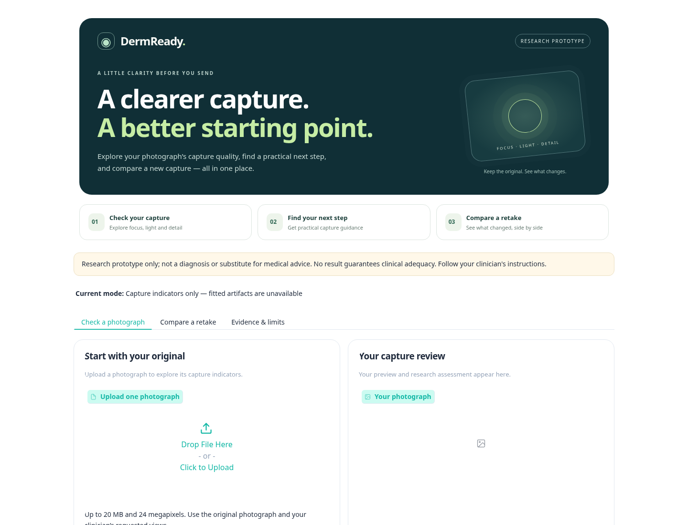

# DermReady

### Check the capture. Improve the retake. Prepare for review.

DermReady helps people preparing photographs for remote dermatology review identify potentially correctable capture problems. It combines measurable image-quality indicators, a fitted research baseline, and a guided **check → retake → compare** workflow.

[**Open the live demo**](https://dermready-hackathon.onrender.com/) · [Demo guide](docs/DEMO_GUIDE.md) · [Model card](docs/MODEL_CARD.md) · [Evaluation](reports/heldout_test.md)


> **Research prototype:** DermReady assesses capture indicators and estimates suitability for review. It does not diagnose skin conditions or guarantee clinical adequacy. A clinician remains responsible for clinical assessment.

## Why DermReady?

A photograph can be difficult to review because of blur, lighting, low resolution, or insufficient visual information. DermReady gives users actionable capture guidance before they submit a photo and helps them inspect changes after taking another.

Its central design choice is to make uncertainty visible. Measurements, model outputs, retake suggestions, and historical evaluation evidence are presented separately so users can understand what each result supports.

## Features

| Feature | What it provides |
| --- | --- |
| Single-photo check | Validated image upload, preview, and a three-state suitability estimate |
| Capture indicators | Focus, brightness, contrast, clipping, and resolution measurements |
| Retake guidance | Prioritized, non-diagnostic suggestions based on supported indicators |
| Before-and-after comparison | Side-by-side previews and measured changes in capture quality |
| Comparison checks | Warnings for duplicate images and differences in dimensions, aspect ratio, or color |
| Preparation checklist | User-reported capture preparation, separate from model inputs |
| Evidence & limits | Frozen evaluation results, uncertainty coverage, and artifact provenance |
| Synthetic examples | Patient-free targets for exploring blur, lighting, and noise behavior |
| Lightweight hosting | Default baseline inference without loading PyTorch |

## Try the live demo

**[dermready-hackathon.onrender.com](https://dermready-hackathon.onrender.com/)**

1. Open the app and check the **Current mode** label.
2. Use a supplied synthetic example or a permitted, non-identifiable photograph.
3. Review the result, capture indicators, and suggested next action.
4. Take another photograph and use the comparison tab to inspect changes.
5. Open **Evidence & limits** to understand the research basis.

The hosted app was verified on **11 October 2026** with the fitted `quality_baseline` active and its model/policy hashes matching the published evaluation artifacts. Render's free service may take time to wake after inactivity.

### Understanding the result

| Result | Interpretation |
| --- | --- |
| **Likely suitable for review** | The input passes the fitted research policy; clinical adequacy is not guaranteed |
| **May need a retake** | The policy indicates a retake may help; inspect the supporting guidance |
| **Uncertain** | The system cannot make a supported suitability decision |

Uncertainty is an intended outcome. A favorable focus or brightness measurement alone does not establish that a photograph contains sufficient clinical information.

## Interface



*Earlier desktop interface revision in capture-indicators-only mode. The current app includes checking, retake comparison, and research evidence tabs.*

## Run locally

Use **Python 3.12**. Trained artifacts are distributed separately and are not included in the public repository.

### Windows — PowerShell

```powershell
git clone https://github.com/taqi-ul-hassan/DermReady_.git
cd DermReady_
python -m venv .venv
.\.venv\Scripts\Activate.ps1
python -m pip install -r requirements-web.txt
python app.py
```

If PowerShell blocks activation, run the environment's Python directly:

```powershell
.\.venv\Scripts\python.exe -m pip install -r requirements-web.txt
.\.venv\Scripts\python.exe app.py
```

### macOS / Linux

```bash
git clone https://github.com/taqi-ul-hassan/DermReady_.git
cd DermReady_
python3 -m venv .venv
source .venv/bin/activate
python -m pip install -r requirements-web.txt
python app.py
```

Open **http://127.0.0.1:7860**.

Without fitted artifacts, the app runs in explicitly labeled **capture-indicators-only mode** and returns **Uncertain** for suitability. Indicators and comparison remain available.

### Enable the fitted baseline

Extract these files from your existing trained-artifact bundle directly into `checkpoints/`:

| File | Purpose |
| --- | --- |
| `quality_baseline.json` | Fitted feature baseline |
| `decision_policy.json` | Frozen decision policy and quality thresholds |

Keep the exact filenames and contents. Avoid an extra nested folder or a hidden `.txt` extension.

```bash
python scripts/check_installation.py --require-trained
python app.py
```

The readiness checker reports whether a fitted system loads and whether its identity matches the published evaluation.

### Optional CNN and training environment

The MobileNetV3-Small path needs the full dependencies and private `best.pt`, together with its matching decision policy. Follow the [environment guide](docs/ENVIRONMENT.md), then run:

```bash
python app.py --model cnn
```

For training and evaluation, see the [reproduction guide](docs/REPRODUCIBILITY.md) and [Colab notebook](https://colab.research.google.com/github/taqi-ul-hassan/DermReady_/blob/main/notebooks/03_train_and_prepare_demo.ipynb).

## How it works

1. **Validate and prepare:** inspect the uploaded image, handle orientation and transparency, and extract capture-quality features.
2. **Estimate:** apply the fitted quality-feature baseline. An optional CNN uses case-aggregated image embeddings.
3. **Apply the frozen policy:** combine the score, decision bands, and supported quality guards to return one of three states.
4. **Explain and compare:** show the decision reason and measured indicators; compare a subsequent capture without altering either image.

The default baseline was selected using validation data because its full guarded policy produced fewer false acceptances. Model selection and thresholds were frozen before held-out testing.

**Stack:** Python · Gradio · NumPy · OpenCV · Pillow  
**Research tooling:** PyTorch · timm · scikit-learn · Google Colab

## Evaluation and scientific scope

DermReady uses **SCIN case-level gradability supervision**. These labels concern whether a case can be assessed; they are not definitive image-level labels for blur, lighting, or clinical adequacy.

The audited consensus cohort contains **710 cases**, split into **497 training**, **106 validation**, and **107 test** cases. Cases connected by shared image paths or known content hashes stay together to reduce leakage.

The single-image held-out evaluation uses the first-listed image from each case and a **weak case-label proxy**. Its 107 cases include 84 gradable and 23 ungradable cases.

| Default baseline result | Held-out count |
| --- | --- |
| Likely suitable for review | 12 / 107 |
| May need a retake | 34 / 107 |
| Uncertain | 61 / 107 |
| Decision coverage | 46 / 107, approximately 43% |
| False acceptance | 1 / 23 ungradable cases |
| False rejection | 25 / 84 gradable cases |

False acceptance has a **95% interval of 0.8–21.0%**. Error denominators include all cases in the corresponding class, including uncertain outputs. These small-sample results do not establish clinical safety or generalization to every dermatology image.

Controlled blur and lighting stress tests are documented separately. Synthetic examples demonstrate indicator behavior; they are not clinical validation.

See the [held-out report](reports/heldout_test.md), [robustness report](reports/robustness.md), [data audit](reports/data_audit.md), and [split summary](reports/split_summary.md).

### Current limitations

- Single-image use provides less information than the multi-image cases used for supervision.
- No validated skin detector or clinical framing assessment is established.
- Skin-tone and other demographic subgroup performance have not been established.
- External clinical validation and expert image-level annotations remain future work.
- Changing decision thresholds simply to reduce uncertainty would require new validation.

## Deploy your own instance

[**Deploy on Render**](https://render.com/deploy?repo=https://github.com/taqi-ul-hassan/DermReady_)

The repository includes `render.yaml` for a free Python web service. For manual setup:

| Setting | Value |
| --- | --- |
| Branch | `main` |
| Build command | `python -m pip install -r requirements-web.txt` |
| Start command | `python app.py --host 0.0.0.0` |
| Health check | `/` |
| Checkpoint directory variable | `DERMREADY_CHECKPOINT_DIR=/etc/secrets` |

Add `quality_baseline.json` and `decision_policy.json` as **Render Secret Files**, preserving their complete contents, then redeploy. Confirm the current-mode label and artifact provenance in the app.

Do not commit private fitted artifacts or dataset files. The lightweight hosted runtime supports the baseline; the optional CNN needs full dependencies and suitable resources. See the [deployment guide](docs/DEPLOYMENT.md) for all environment settings and checks.

## Repository guide

| Path | Contents |
| --- | --- |
| `app.py` | Gradio app and capture-review workflow |
| `src/` | Data handling, preprocessing, features, models, inference, and feedback |
| `scripts/` | Dataset preparation, integrity checks, and installation checks |
| `notebooks/` | Environment, audit, split, and training workflows |
| `configs/` | Experiment configuration |
| `tests/` | Automated regression checks |
| `reports/` | Published aggregate results and artifact provenance |
| `docs/` | Setup, deployment, model card, privacy, and research documentation |
| `assets/demo/` | Permitted public demonstration assets |
| `checkpoints/` | Local private model artifacts |
| `data/` | Local private dataset and split artifacts |

## Verification

The project includes full-runtime Linux and Windows CI plus lightweight cloud-runtime checks. The deployment preparation passed startup, synthetic upload/comparison, and private-path access checks.

For the full development environment:

```bash
python -m pip check
python -m pytest
```

Private trained-artifact checks require the matching artifact bundle. Consult the [project review](docs/PROJECT_REVIEW.md) for verified improvements and outstanding research gaps.

## Privacy and responsible use

Use only synthetic or permitted, non-identifiable images in the public demo. Uploaded photographs are not added to the training dataset. Gradio temporary upload/preview files have periodic cleanup; hosting logs and browser caches are outside that cleanup.

The app blocks private data and artifact paths and disables analytics/run history. These settings do not guarantee anonymous hosting or instant deletion. Never commit patient photographs, case manifests, credentials, or private model files.

## Documentation

- [Windows quick start](docs/WINDOWS_QUICKSTART.md)
- [Run guide](docs/RUN_APP.md)
- [Deployment guide](docs/DEPLOYMENT.md)
- [Reproduction guide](docs/REPRODUCIBILITY.md)
- [Model card](docs/MODEL_CARD.md)
- [Comprehensive project review](docs/PROJECT_REVIEW.md)
- [SCIN usage and attribution](docs/SCIN_USAGE.md)

## License and acknowledgments

The project code is released under the [MIT License](LICENSE). Dataset images, labels, and pretrained weights have separate terms; the code license does not grant rights to those materials.

Built by [Taqi Ul Hassan](https://github.com/taqi-ul-hassan).

Acknowledgments: [SCIN / Google Research](https://github.com/google-research-datasets/scin), [timm / Ross Wightman](https://github.com/huggingface/pytorch-image-models), [MobileNetV3-Small pretrained model](https://huggingface.co/timm/mobilenetv3_small_100.lamb_in1k), PyTorch, torchvision, OpenCV, scikit-learn, Pillow, and Gradio. AI coding and documentation assistance: ChatGPT/Codex.
