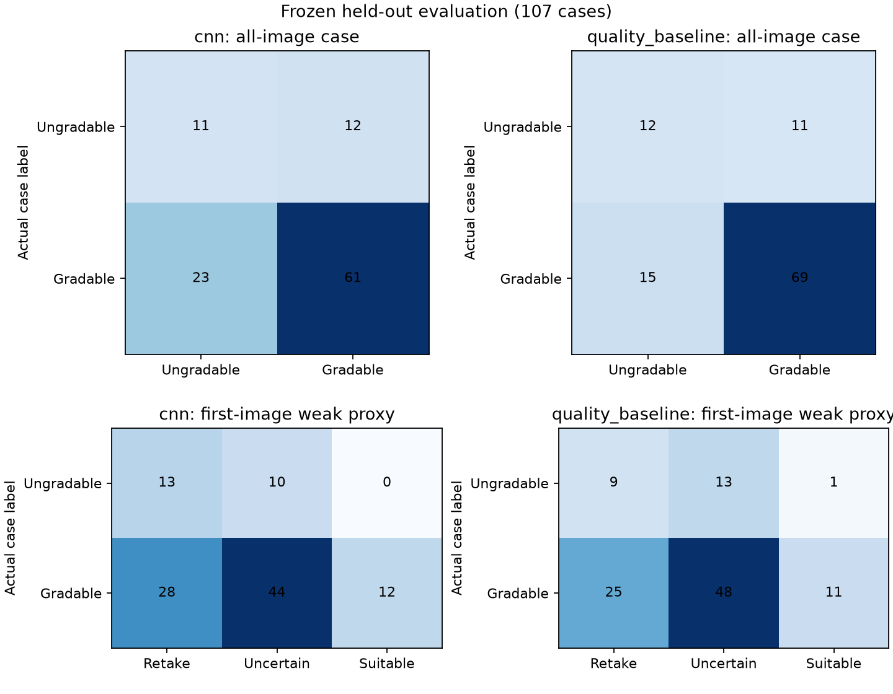

# Step 11: frozen held-out evaluation

Evaluated 107 SCIN cases (84 gradable, 23 ungradable), comprising 299 images. All images decoded successfully. Artifacts and all split CSVs were SHA-256 frozen before test downloads and verified unchanged after evaluation. No training, threshold selection, or default-model changes were made using this test set.

## All-image case classification

Binary decision threshold is fixed at 0.5; these results are distinct from the three-state app. Confusion matrices use actual rows and predicted columns in [ungradable, gradable] order.

| Model | Balanced accuracy | ROC-AUC | F1 ungradable | Ungradable recall | False acceptance | False rejection |
| --- | ---: | ---: | ---: | ---: | ---: | ---: |
| cnn | 0.602 | 0.701 | 0.386 | 47.8% | 52.2% | 27.4% |
| quality_baseline | 0.672 | 0.645 | 0.480 | 52.2% | 47.8% | 17.9% |

## Single-image app: weak case-label proxy

Each case contributes its fixed first-listed image. The unchanged app pipeline includes its validation thresholds and capture guards. A case label is not definitive truth about this particular image.

| Model | Suitable | Retake | Uncertain | False acceptance / 23 | False rejection / 84 | Decision coverage |
| --- | ---: | ---: | ---: | ---: | ---: | ---: |
| cnn | 12 | 41 | 54 | 0/23 (0.0%) | 28/84 (33.3%) | 49.5% |
| quality_baseline | 12 | 34 | 61 | 1/23 (4.3%) | 25/84 (29.8%) | 43.0% |

False acceptance divides suitable outputs with an ungradable case label by all 23 ungradable cases. False rejection divides retake outputs with a gradable case label by all 84 gradable cases. Uncertain cases remain in those denominators. Decision coverage counts retake or suitable outputs divided by all 107 cases. Three-state ungradable recall counts explicit retakes only; uncertain is not treated as a correct rejection.

## Error review and limits

- Default baseline: one weak-proxy false acceptance; 25 gradable cases sent to retake; 48 gradable and 13 ungradable cases uncertain. One of its 12 suitable outputs had an ungradable case label (8.3%).
- CNN: zero weak-proxy false acceptances observed, but 28 gradable cases sent to retake and 54 cases uncertain. Zero of 23 is not evidence of zero risk: its false-acceptance Wilson 95% upper bound is 14.3%.
- Default baseline false-acceptance Wilson 95% interval is 0.8%–21.0%; false-rejection interval is 21.0%–40.2%. The small ungradable sample cannot support a clinical safety claim.
- Retake suggestions cannot establish the cause of case-level ungradability, and a clearer photograph may not resolve missing clinical information.
- The default remains the validation-selected quality baseline. Choosing CNN because of these test results would reuse the final test set for model selection.
- Strict multi-reviewer consensus retains a small selected subset of SCIN; results may not generalize to excluded or outside-source cases. No reliable skin detector, anatomical framing model, clinical image-level labels, or subgroup assurance is established.
- Test results are final reporting data for this version. Future model/policy changes require independent evaluation. Six test images had earlier been decoded in a pre-split readability audit; none were used for training or policy selection.



## Reproduction

After preparing the same private manifests, split CSVs, and frozen trained artifacts:

```bash
python scripts/evaluate_test.py
```

On Windows with an existing local virtual environment:

```powershell
.\.venv\Scripts\python.exe scripts\evaluate_test.py
```

The script explicitly downloads/decode-checks only the test images into the private cache. It refuses to overwrite an existing final test report. A demo-only ZIP installation lacks the private manifests/split CSVs: no additional local command is needed to view the committed report. Use a fresh reproduction workspace to rerun the same frozen experiment, and do not tune against the resulting test metrics.

Aggregate reports and plots are public. Images, case IDs, and per-case predictions remain private. All 29 automated checks passed. Controlled degradations remain step 12.
