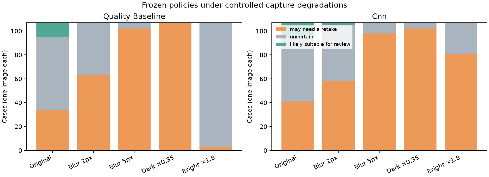

# Step 12: controlled capture stress tests

Both unchanged app policies were tested on the fixed first-listed image from each of 107 held-out cases. The five conditions were recorded before running: original, Gaussian blur radius 2 and 5 source pixels, brightness multiplied by 0.35 and 1.8. Model/policy hashes match the frozen final evaluation. No tuning or default change followed these experiments.

| Model | Condition | Suitable | Retake | Uncertain | Originally suitable still suitable / 12 |
| --- | --- | ---: | ---: | ---: | ---: |
| quality_baseline | original | 12 | 34 | 61 | 12/12 |
| quality_baseline | blur_2 | 0 | 63 | 44 | 0/12 |
| quality_baseline | blur_5 | 0 | 102 | 5 | 0/12 |
| quality_baseline | dark_035 | 0 | 107 | 0 | 0/12 |
| quality_baseline | bright_180 | 0 | 3 | 104 | 0/12 |
| cnn | original | 12 | 41 | 54 | 12/12 |
| cnn | blur_2 | 2 | 58 | 47 | 2/12 |
| cnn | blur_5 | 0 | 98 | 9 | 0/12 |
| cnn | dark_035 | 0 | 102 | 5 | 0/12 |
| cnn | bright_180 | 0 | 81 | 26 | 0/12 |

## Findings and limits

- The default baseline returned no suitable outputs under any tested degradation. Mild blur produced 63 retakes; stronger blur produced 102. Darkening produced 107 retakes; brightening mostly produced uncertainty (104/107).
- The CNN retained two suitable outputs under 2-pixel blur. Both came from originally suitable outputs. Stronger blur, darkening, and brightening eliminated suitable outputs.
- Focus flags rose from 7/107 originally to 33/107 under mild blur and 103/107 under stronger blur. Dark flags rose to 107/107 after darkening; bright flags to 104/107 after brightening.
- Darkening also reduces the focus proxy: capture indicators are coupled, so a focus flag does not uniquely establish defocus.
- Gaussian radius is measured in source pixels, not a resolution-normalized optical blur. Two-pixel blur may be mild on large images. Brightening clips channels and can change contrast and texture as well as exposure.
- Edited images have no new clinical suitability labels. These are paired response experiments, not corruption accuracy or proof that every retake is correct.
- No unrelated-image detector is validated. Synthetic target demonstrations measure software behavior only and must not be presented as skin-photo validation.
- No test outcomes were used to change the app, select thresholds, or change the default. Independent evaluation is required for future model/policy changes.



## Reproduction

Run after the frozen step-11 evaluation and with the same private cache, manifests, and artifacts:

```bash
python scripts/evaluate_robustness.py
```

The script refuses to overwrite the final stress-test report. Only aggregate metrics/plots are published; edited patient images and per-case predictions remain private.
